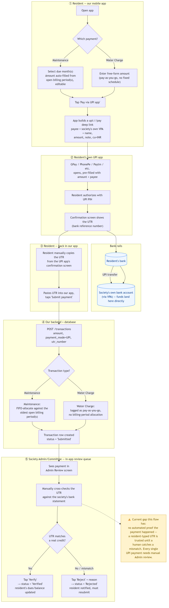

# Current Transaction Flow — UPI Payments (Maintenance & Water Charges)

This covers the **current, pre-PaySharp** flow for the two UPI-based payment types in the app today. Cash payments (Admin-recorded, auto-verified, no UPI/UTR involved) are out of scope for this diagram.

- **Monthly Maintenance** — a fixed recurring due per house, billed month over month. Payment amount is derived from the resident's selected open billing period(s) (FIFO allocation, oldest month first).
- **Extra Water Charges** — pay-as-you-go, no fixed schedule or billing period; the resident enters whatever amount the society has told them to pay.

Both payment types share the exact same UPI mechanics and manual-review process — they only differ in step ① (how the amount is chosen) and step ④ (how the backend allocates the payment once submitted).

## Step-by-step

1. **Resident — our mobile app.** Resident picks Maintenance (selects due month(s), amount auto-fills from the open billing period(s)) or Water Charge (types in a free-form amount). Taps "Pay via UPI app." The app builds a plain `upi://pay` deep link using the **society's own VPA and payee name** — no PaySharp/aggregator involved yet.
2. **Resident's own UPI app.** Whatever UPI app they have installed (GPay, PhonePe, Paytm, etc.) opens pre-filled with the amount and payee. Resident authorizes with their UPI PIN and lands on a confirmation screen showing the UTR (bank reference number).
3. **Money movement.** Funds move directly, bank-to-bank via UPI, from the resident's bank to the **society's own bank account** (via its VPA). We never touch the money.
4. **Resident — back in our app.** Resident manually copies the UTR from their UPI app and pastes it into ours, then taps "Submit payment." Our backend records the transaction as `Submitted` and, for Maintenance, allocates it FIFO against the oldest open billing period(s); Water Charge is just logged with no allocation.
5. **Society Admin/Committee — in-app review queue.** An Admin sees the submission in a review queue, manually cross-checks the typed UTR against the society's own bank statement, and taps **Verify** (marks it `Verified`, updates the resident's dues/balance) or **Reject** with a reason (resident is notified and must resubmit).

## The gap this creates

There is no automated proof that a payment actually happened — a resident-typed UTR is trusted until a human catches a mismatch, and **every single UPI payment currently requires manual Admin review** against the bank statement. This is exactly the gap we'd like PaySharp's **UPI Intent API** to close (per our earlier email): replacing steps ①–④ with a backend-initiated `POST /order/intent` call and a webhook-confirmed outcome, so Verify happens automatically on a `SUCCESS` webhook instead of requiring a human to eyeball a bank statement.
